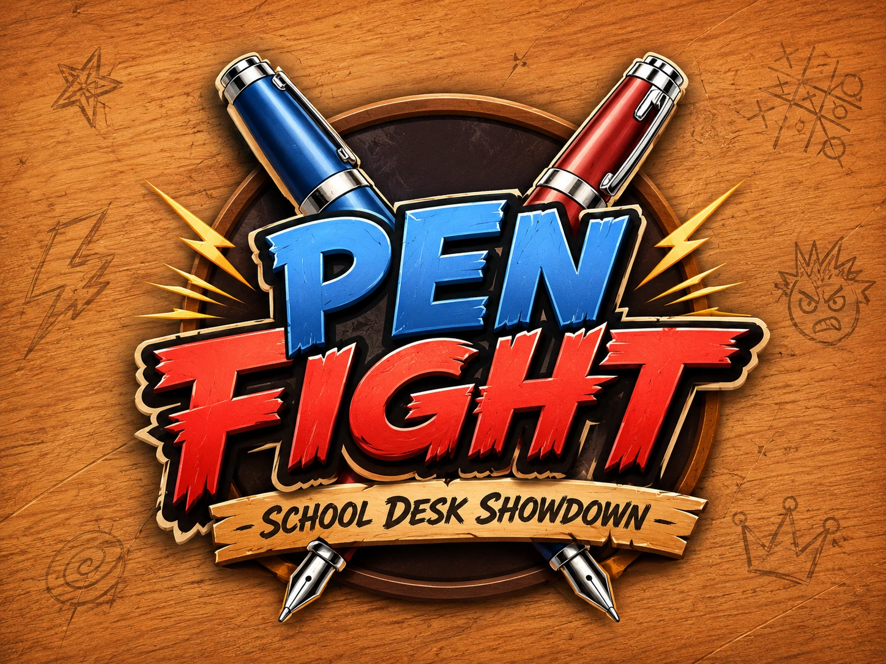
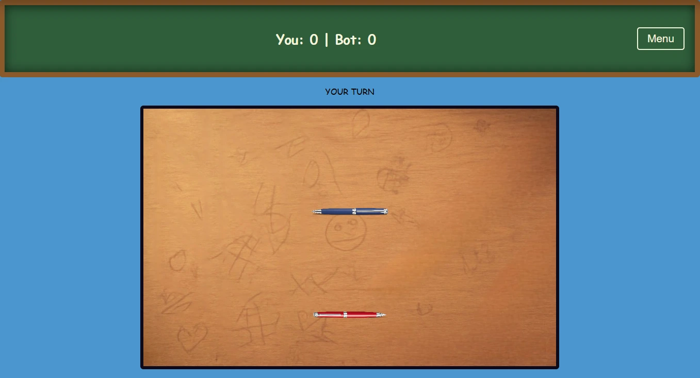
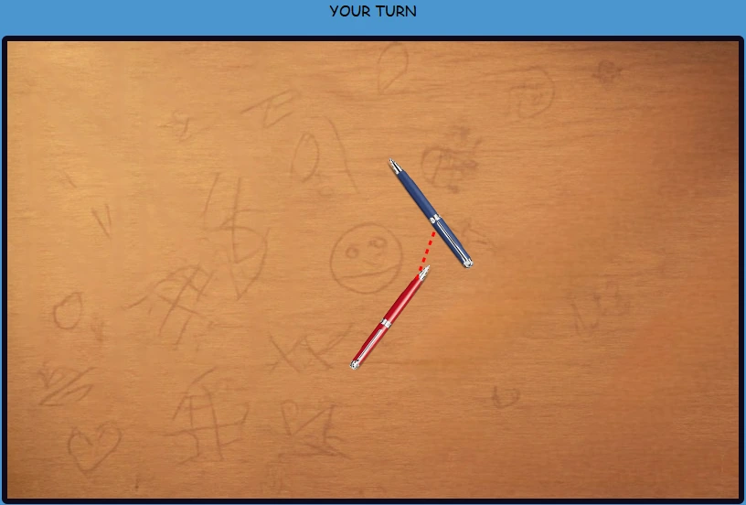
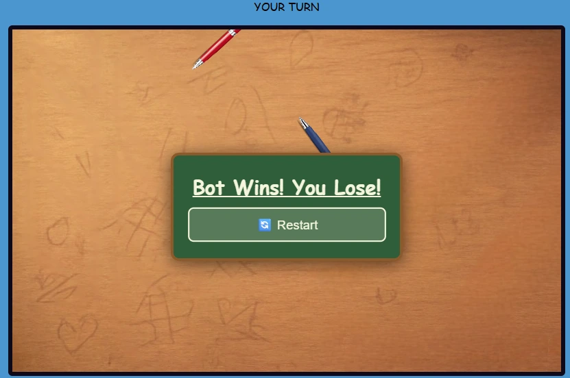

# Pen Fight

[Play Pen Fight](https://penfight.org/)

Pen Fight is a browser game destination built around a small but satisfying challenge: send an opponent's pen off the desk without losing your own. You control the red pen, while the blue pen is your opponent. Direction, force and the shape of the collision all matter. A powerful shot is not automatically a good shot, especially when your own pen is already close to an edge.

## Understand your first shot

Press the red pen and drag to aim. Think of the gesture like pulling back a slingshot: the release sends the pen in the opposite direction from the drag. Start with a modest movement so that you can see how the aiming direction relates to the result. Release to take the shot, watch the collision, and wait for the opponent's action before deciding what to do next.

The immediate objective is simple, but the desk creates a positional puzzle. Look at the nearest edge behind the opponent and the space behind your own pen. If a direct hit would carry both pens toward danger, consider a more restrained angle. Learning to stop in a useful position can be more valuable than trying to win with the first move.

## Read the collision

Pens are long objects rather than round balls. Contact near a tip can produce a different rotation from contact near the middle. A glancing hit may redirect an opponent without transferring all your motion straight ahead. Watch the entire movement after each release, not just the first impact. The final resting position tells you what the next turn will look like.

A practical learning exercise is to change only one decision between attempts. Keep the direction similar and reduce the force, or keep the force modest and change the angle. This makes it easier to understand what caused a result. Randomly changing everything at once can make a lucky win feel good, but it teaches less about repeating the same success.

## Balance attack and safety

Before releasing, ask where your pen is likely to finish. A tempting attack can leave you exposed to a straightforward reply. When you are near an edge, a safer position may be worth more than an aggressive collision. There is no need to treat every turn as a maximum-power attempt. A controlled move can create a better opportunity for the following turn.

The blue opponent's position matters just as much as yours. Notice whether the pen is parallel to an edge, pointing toward open space, or positioned to strike back along a clear line. These observations help you choose a direction deliberately. The game remains a physics challenge, so use these ideas as things to test rather than guaranteed winning formulas.

## Use the website alongside the game

The website brings the game together with explanations, practical tips, frequently asked questions and gameplay videos. If the drag direction feels confusing, read the controls and watch an example before trying again. A short explanation can be easier to apply when you immediately return to the same situation in the game.

The surrounding page also offers related games through its navigation and game cards. Those links are separate activities, not additional Pen Fight levels. Choose them when you want a different kind of challenge, and return to the main game when you want another desk duel. The website does not need to be treated as a technical project to enjoy it.

## Keep personal results in perspective

The site's local result features are intended for personal tracking in the current browser. A locally recorded result is not a verified global competition entry. If you use a nickname or notes, choose information you are comfortable keeping on that device. Shared computers deserve particular care because another person may use the same browser profile later.

Clearing browser storage or moving to another device can affect locally retained records. Do not assume that a result will follow you automatically between browsers. If a particular score matters to you, keep your own record as well. Local tracking is a convenient companion to play, not a substitute for a durable personal archive.

## A comfortable short session

A desktop pointing device gives you room to learn the drag gesture and observe the aiming line. Keep the game area fully visible, avoid accidental page scrolling during a move, and take a moment to locate the active controls before starting. Screen size and input behavior vary between devices, so do not assume that a narrow phone display will feel identical to a desktop.

If the game does not respond as expected, first make sure it has finished loading and that your pointer is interacting with the game rather than the surrounding page. Avoid reloading immediately after a result you wanted to record. The site's help text and videos can clarify the intended interaction without requiring you to guess from a single failed attempt.

## Independent game destination

Pen Fight is an unofficial browser destination. Game names, artwork and other creative materials remain associated with their respective owners. The site provides a place to play and learn, not a claim of ownership over every game shown in its recommendations.

For details about the website and visitor information, use its About, Privacy, Contact and Terms pages. When reporting a problem, describe the device, browser and action that led to it without including passwords or other sensitive information. A clear description of what you expected and what happened is more useful than a score alone.

[Return to Pen Fight](https://penfight.org/)
